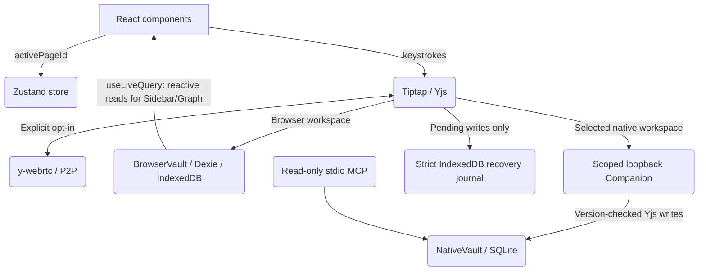

# Ephemeris

> A local-first knowledge workspace with an independent browser workspace and an explicitly selected SQLite Native Vault.

[](https://opensource.org/licenses/MIT)


## Motivation

I wanted a Notion I owned. Not a cheaper Notion or a faster one, but one where the notes sit on my machine and keep working when a company changes its pricing, its terms, or its mind about staying in business. The long-term idea was to put a model on top of my own notes rather than hand them to someone else's.

Ephemeris is the first cut at that substrate. The browser workspace needs no account or application server. A separate Native Vault stores Yjs documents in SQLite and supports local editing through a scoped Companion, optional self-hosted sync and read-only local MCP tools. Browser data is never migrated automatically.

## What It Does

- **Hierarchical Document Model:** Organise browser notes with nested sub-pages, drag-and-drop re-parenting, collapsible tree toggles, and interactive breadcrumbs.
- **Optional Collaborative Editing:** Explicitly enable browser WebRTC collaboration with configured signalling servers. Local editing makes no signalling requests by default.
- **Unified Details Panel:** Access sub-pages and backlinks via a dockable panel (bottom or right sidebar) to maintain context without cluttering the editor.
- **Graph View:** Visualise connections between pages linked via `[[wiki-link]]` syntax on an interactive 2D physics graph.
- **Rich Text Editing:** Write using Tiptap's markdown-style input rules and keyboard shortcuts, complete with mathematical formulas (KaTeX), code blocks, and double-click whitespace trimming.
- **Customisation:** Assign pages an icon (from a full 1,484 Unicode catalogue, uploaded images, or remote URLs) and a cover image, stored inline.
- **Offline & Recoverable:** BrowserVault keeps canonical Yjs documents and attachment records in IndexedDB, with explicit JSON backup/import. Native Vault offers verified snapshots and restoration to a separate directory.
- **Native Editing:** Create, edit, rename, move, trash and restore notes with optimistic version checks, retained pending drafts and explicit conflict recovery. Quick Capture, Daily Notes, meeting templates, tags, properties and saved table/card/Kanban views use the same Vault.
- **Local Agent Tools:** A read-only stdio MCP server exposes bounded note, search, link, change and task projections. The server makes no cloud requests; a consuming agent may transmit responses to its model provider.

No sign-up is required. Browser editing works offline after the application shell has been cached. Native editing requires the local Companion; interruptions retain pending drafts for explicit recovery. See the [Native Vault guide](docs/native-vault.md) before using important data.

## Architecture



Each workspace has one canonical store: BrowserVault in IndexedDB, or NativeVault in SQLite. Yjs represents rich text in both. The native browser journal contains pending recovery writes, not an independently editable copy of the Vault. [Architecture and safety contracts](docs/native-vault.md) describe explicit migration, snapshots and optional sync.

## Tech Decisions

| Component | Choice | Why this over alternatives |
| --- | --- | --- |
| Storage | Dexie.js over raw IndexedDB | The native IndexedDB API is event-based and verbose for even simple queries. Dexie gives promises, and `useLiveQuery` turns a table into a reactive source, which removes the need for a data-fetching layer |
| Native storage | Node SQLite with Yjs BLOBs | Transactions cover note versions, metadata, attachments and the change journal; a separate process exposes narrow local operations |
| CRDT | Yjs over Automerge | Yjs has mature ProseMirror/Tiptap integration and modular persistence and sync providers such as `y-webrtc` and `y-indexeddb` |
| Sync | Optional browser WebRTC; native authenticated HTTP provider | Browser peers explicitly configure signalling. Native devices use the existing self-hosted Node/SQLite provider with durable acknowledgements, bounded payloads and retained conflict history |
| Graph View | react-force-graph-2d over raw D3 | Provides a canvas-based physics simulation for note connections without manually managing D3 DOM updates inside React |
| Editor | Tiptap over a textarea or a markdown parser | ProseMirror stores the document as structured JSON, not a string. Block-level features later depend on the content already being a tree |
| State | Zustand | Shared workspace readiness, navigation and browser state stay separate from each native editor's document/session lifetime |
| Testing | Vitest + RTL over Jest | Native ESM and Vite integration keep configuration small and support fast local feedback |

## Results & Limitations

- **Development acceptance.** [CI for the UI audit at `8b00661`](https://github.com/liminal-cipher/ephemeris/actions/runs/42270936866) passed on macOS, Windows and Ubuntu: 69 unit, 132 native and 49 browser tests per runner, including all three browser engines and the macOS temporary-directory regression. Shipping Safari, physical OS IME behaviour and human acceptance remain separate checks.
- **Recovery and capacity.** Browser storage can be evicted. Keep verified native snapshots; sync history is deliberately retained and has resource limits. [Synthetic measurements](docs/sync-benchmarks.md) cover 3,000 native notes, not all browser-sidebar workloads.
- **Replacement gaps.** Markdown/Obsidian/Joplin migration, a complete sync/history UI, native installers and signing remain unfinished. This is not yet a validated Obsidian/Joplin replacement.

## Getting Started

Requires Node.js 22.12 or later for the browser app, and Node.js 24.15 or later for Native Vault's built-in SQLite. This revision was tested with Node.js 24.20.0.

```bash
git clone https://github.com/liminal-cipher/ephemeris.git
cd ephemeris
npm ci
npm run dev
```

The browser workspace needs no keys or backend. Follow the [native editing instructions](docs/native-vault.md#explicit-native-editing-and-recovery) to start a local Companion with a private, short-lived session file. Existing read-only sessions never acquire write permission.
Run `npm test`, `npm run test:native`, and, after `npm run build` and installing Playwright's Chromium/Firefox/WebKit engines, `npm run test:e2e`.

## Roadmap

- [x] **Done:** Local-first core & CRDTs: Offline workspace management with Yjs CRDTs, unified panels, and Graph View.
- [ ] **Next:** Performance optimisation: Virtualised rendering for the sidebar tree to support workspaces scaling past thousands of notes smoothly.
- [x] **Done:** Cover media options: Local image uploads, custom image URLs, and curated Unsplash presets for page covers.
- [ ] **Next:** Multi-page bulk operations: Dragging and re-parenting multi-selected notes simultaneously in the sidebar tree.
- [x] **Done:** Tiptap 3.33 upgrade with Yjs, maths and rich-text compatibility tests.
- [x] **Done:** Authenticated self-hosted HTTP sync provider, scoped native editing, daily workflows, saved views and read-only stdio MCP.
- [ ] **Next:** Portable Markdown migration, fuller recovery/sync UI, cross-platform acceptance and a desktop launcher. Transport authentication does not provide end-to-end encryption.

## Status

In progress. Local development workflow; no production deployment or packaged desktop release. Last updated 2026-11-07. See the [current verification handoff](docs/ephemeris-2-handoff.md) for results and remaining gates.

## Licence

MIT. See [LICENSE](LICENSE).
